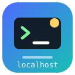

<p align="center"></p>
<p align="center"><strong>dsh-local-opencode</strong></p>

# Local OpenCode for DeepSeek Harness

English | [简体中文](README_CN.md)

[](https://github.com/gzxc-vbnm/dsh-local-opencode/actions/workflows/ci.yml) [](https://github.com/topics/dsh-plugin)  

The free models you already have in [opencode](https://opencode.ai), selectable inside [DeepSeek Harness](https://github.com/deepseek-ai/deepseek-harness) (`dsh`). No login, no API key, no extra quota to buy: the plugin finds the opencode server already running on your machine, reads the models it can actually serve, and registers the zero-cost ones as a model provider, so `dsh`'s model picker shows a **Local OpenCode** group.

## Why it goes through your local opencode

This is the whole design decision, and it is measured rather than assumed. opencode's anonymous free lane does not admit direct clients: posting to `https://opencode.ai/inference/openai/v1` with the public key, the OpenAI `chat/completions` shape, the `responses` shape, and the full attribution header set opencode itself sends (`x-opencode-session-id`, `x-opencode-project`, `x-session-affinity`, `User-Agent: opencode/...`) returns

```json
{"type":"error","error":{"type":"FreeUsageLimitError","message":"Free usage limit reached. ..."}}
```

while the *same model* answers in about 1.5 seconds when the request goes through the local opencode server, which carries the session identity the quota is bound to. Some models are additionally region-gated (`RegionError`), which is why the plugin reports the failure instead of hiding it.

So the plugin is a bridge to your local opencode, not a second client for its upstream.

## What you get

| | |
|---|---|
| **Model groups** | `Local OpenCode` (zero-cost only) and `Local OpenCode · 计费模型`, which stays empty unless you opt in, so the default picker shows nothing but free models |
| **Catalog source** | `GET /api/model` on your own machine: channels you log into later show up without touching this plugin |
| **Reasoning effort** | mapped onto opencode model variants (`low` / `high` / `max` …); only the variants the catalog declares are offered |
| **Context and output caps** | read from the catalog, so `dsh` budgets and compaction see the real numbers |
| **Failure reporting** | region blocks, quota walls and rate limits surface as their own codes with the provider's backoff, and are deliberately not retried |
| **Status surface** | `/api/local-opencode/status`, `/refresh`, `/test` behind the host's own admission fence |

## Install

Requirement: opencode installed and signed in on the same machine (`npm i -g @opencode/cli`, then run `opencode` once, or `opencode serve`). Its service registration in `~/.local/state/opencode/service.json` is what this plugin reads.

```powershell
# from a checkout
dsh plugin --profile web add link:C:/path/to/dsh-local-opencode

# or once published to npm
dsh plugin --profile web add dsh-local-opencode
```

Restart `dsh`. The bundle layer in `cordis.patch.yml` mounts the plugin; nothing else to wire up.

## Configuration

`~/.dsh/local-opencode/settings.json`, overridable by the bundle `config` (config wins):

| Key | Default | Effect |
|---|---|---|
| `enabled` | `true` | `false` registers no route: the group leaves the picker, the settings stay |
| `includePaid.githubCopilot` | `false` | list GitHub Copilot models (billed by your Copilot plan) |
| `includePaid.others` | `false` | list every other non-zero-cost channel |
| `refreshMinutes` | `30` | background catalog refresh; `0` refreshes only at boot and on demand |
| `requestTimeoutMs` | `180000` | per-call upstream timeout (clamped to 5s–30min) |

Environment overrides: `OPENCODE_SERVER_URL` / `OPENCODE_SERVER_PASSWORD` bypass the registration file (a non-loopback URL is accepted here, since you are configuring your own machine).

## How one turn is served

```
dsh GenerateOptions
  -> history flattened to a prompt (system + turns + tool results as text)
  -> POST /api/session                     create
  -> POST /api/session/{id}/model          model + variant (= reasoning effort)
  -> POST /api/session/{id}/generate       one stateless generation
  -> DELETE /api/session/{id}              in finally, always
  -> block-start / text-delta / block-end / usage / finish
```

The session exists only to carry the identity the free lane is metered against. `generate` does not accumulate history (verified: asking twice in one session, the second answer does not remember the first), which matches `dsh` replaying the full transcript on every turn, and deleting the session leaves nothing behind in your opencode session list.

## Limitations

- **No function calling.** This lane takes text and returns text. Tool declarations are dropped and history is flattened, with a closing note telling the model not to announce tool calls. Use these models for chat, drafting, summarising and analysis, not as a coding agent inside `dsh`.
- **No image input.** Blocks are projected to placeholder text, and `inputModalities` says `text` only, so the harness does the projection rather than the plugin pretending.
- **Quota and region are the channel's, not ours.** The catalog is read live, so its size moves with opencode's own offerings; models that your network cannot reach report `RegionError` with the reason, and quota walls carry the provider's backoff. The picker shows whatever your machine can actually list, not a frozen table.
- **Whole-turn streaming.** opencode answers the generation in one payload, so the response arrives as a single delta instead of a token stream.

## Development

```powershell
npm run check            # parse every module (no build step exists to catch a typo)
npm test                 # syntax + bundle manifest + classifier + settings + contract
npm run test:live        # against the real local opencode, one round per free model
npm run test:kernel      # against the published harness kernel (needs DSH_ROOT)
```

| Suite | What it pins | Count |
|---|---|---|
| `scripts/check-syntax.mjs` | every shipped module parses | 16 files |
| `scripts/bundle-manifest-check.mjs` | bundle wiring, tarball file list, repo metadata | 28 checks |
| `test/classifier.mjs` | failure mapping, branch by branch, plus own-property failure shape | 16 asserts |
| `test/settings.mjs` | defaults, override order, clamping, atomic flush, restart reload | 19 asserts |
| `test/mock-runtime.mjs` | the adapter against a minimal cordis + fake opencode | 49 asserts |
| `scripts/kernel-contract-check.mjs` | adapter methods, chunk types, failure codes vs the published kernel | 4 groups |
| `test/live.mjs` | the real local opencode, one round per zero-cost model | environment |


The contract suite runs the plugin against a minimal cordis context and a fake opencode server, and asserts what the real kernel asserts: `registerAdapter` calls `providerInfo` and `providerRetryPolicy` on every route and requires the backoff fields at the top level; `prepareCall` is awaited and its `.model` is validated synchronously (a missing `await` hands the kernel a Promise and dies with `INVALID_MODEL_INFO` — found on a real boot, now pinned by a test); `normalizeModelInfo` requires `id` to equal the requested model, a non-empty name, an integer context window and unique effort ids; and a stream must be exactly `block-start`, `text-delta`, `block-end`, `usage`, `finish`.

`scripts/kernel-contract-check.mjs` closes the gap that structural typing opens: it reads the published harness source and fails if the kernel starts calling an adapter method we do not implement, emits a chunk type it does not know, or if a failure code we produce is not in its vocabulary.

## Verified on

| opencode | dsh | Node | result |
|---|---|---|---|
| 2.2.5 | 0.2.1-rc.2 | 24.21 | the whole zero-cost slice of the catalog answered in ~1.5s each; `crouton-alpha-free` and `beam-free` returned `RegionError` |

## License

MIT — see [LICENSE](LICENSE).

