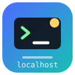

<p align="center"></p>
<p align="center"><strong>dsh-local-opencode</strong></p>

# Local OpenCode for DeepSeek Harness

English | [简体中文](README_CN.md)

[](https://github.com/gzxc-vbnm/dsh-local-opencode/actions/workflows/ci.yml) [](https://www.npmjs.com/package/dsh-local-opencode) [](https://github.com/topics/dsh-plugin)  

The free models you already have in [opencode](https://opencode.ai), selectable inside [DeepSeek Harness](https://github.com/deepseek-ai/deepseek-harness) (`dsh`). No login, no API key, no extra quota to buy: the plugin finds the opencode server already running on your machine, reads the models it can actually serve, and registers the zero-cost ones as a model provider, so `dsh`'s model picker shows a **Local OpenCode** group.

## Why it goes through your local opencode

This is the whole design decision, and it is measured rather than assumed. opencode's anonymous free lane does not admit direct clients: posting to `https://opencode.ai/inference/openai/v1` with the public key, the OpenAI `chat/completions` shape, the `responses` shape, and the full attribution header set opencode itself sends (`x-opencode-session-id`, `x-opencode-project`, `x-session-affinity`, `User-Agent: opencode/...`) returns

```json
{"type":"error","error":{"type":"FreeUsageLimitError","message":"Free usage limit reached. ..."}}
```

while the *same model* answers in about 1.5 seconds when the request goes through the local opencode server, which carries the session identity the quota is bound to. Some models are additionally region-gated (`RegionError`), which is why the plugin reports the failure instead of hiding it.

So the plugin is a bridge to your local opencode, not a second client for its upstream.

## Two channels, and why the safe one is the default

| | text only (default) | agent (with tools) |
|---|---|---|
| Endpoint | `POST /api/session/{id}/generate` | `POST /api/session/{id}/prompt` + `GET /api/event` |
| Tools | none, ever | opencode's own: read, write, bash, grep ... |
| Side effects | none | **really reads and writes your files** |
| Reasoning blocks | no | yes, streamed separately |
| Streaming | one whole payload | event stream: text, reasoning, step, usage, permission |

The text channel is the default because it is the one with no blast radius: it takes a prompt and returns text, and nothing on your disk can change. The agent channel is a different lane entirely — opencode runs its own tool loop in a working directory you choose, and `dsh` only ever sees the final text and reasoning. That is genuinely useful for work that needs the filesystem, and it is exactly why the plugin does not enable it silently.

**The permission policy is not decoration.** Measured on opencode 2.3.0: the `build` agent's default permission is `*=allow`, and tools execute *silently* — no `permission.asked` event is emitted at all. A plugin that only *reports* a permission setting would therefore be lying. This one sends `permissions` when it creates the session:

| Policy | Sent at session creation | On each `permission.asked` |
|---|---|---|
| Read only (default) | `{action:"*", effect:"ask"}` | read/search/list actions answered `once`; everything else `reject` |
| Allow everything | `{action:"*", effect:"allow"}` | nothing to answer — tools just run |
| Reject everything | `{action:"*", effect:"deny"}` | nothing to answer — the server refuses (verified: the file was not written) |

## What you get

| | |
|---|---|
| **Model groups** | `Local OpenCode` (zero-cost only) and `Local OpenCode · 计费模型`, which stays empty unless you opt in, so the default picker shows nothing but free models |
| **Catalog source** | `GET /api/model` on your own machine: channels you log into later show up without touching this plugin |
| **Reasoning effort** | mapped onto opencode model variants (`low` / `high` / `max` …); only the variants the catalog declares are offered |
| **Context and output caps** | read from the catalog, so `dsh` budgets and compaction see the real numbers |
| **Failure reporting** | region blocks, quota walls and rate limits surface as their own codes with the provider's backoff, and are deliberately not retried. Region blocks are `INVALID_REQUEST`, not `AUTH`, because the chat UI rewrites `AUTH` into a fixed "API key is invalid" and drops the real reason |
| **Sidebar panel** | a **Local OpenCode** row in the sidebar: per-model show/hide, the channel switch, and the agent-channel settings, all on one page |
| **Two channels** | *text only* (stateless, no tools, no side effects) or *agent* (opencode's own tool loop, which really reads and writes your files, gated by a permission policy you choose) |
| **Status surface** | `/api/local-opencode/status`, `/refresh`, `/test`, `/visibility`, `/channel`, `/agent-settings`, `/agents`, `/runtime`, `/service`, `/install` behind the host's own admission fence |
| **Background service** | on load the plugin probes for the binary and runs `opencode service start` *before* the first catalog refresh, so the panel never opens against a service that is still booting; skipped when `OPENCODE_SERVER_URL` is set |
| **One-click install** | no opencode on this machine? The panel offers the exact command and a button that runs it. On a machine that already has one, that block is not rendered at all |

## Install

Requirement: opencode on the same machine, signed in. If it is not there yet, the panel's install button runs `npm install -g @opencode/cli@latest` for you — note the package name: the bare `opencode` does not exist on npm, and `opencode-ai` is the 1.x line, which speaks a different protocol and would connect to nothing.

Once installed, `dsh` starting is enough: the plugin starts the background service itself and reads its registration in `~/.local/state/opencode/service.json`. You only need to run `opencode` once by hand to sign in.

```powershell
# from npm
dsh plugin --profile web add dsh-local-opencode

# or from a checkout
dsh plugin --profile web add link:C:/path/to/dsh-local-opencode
```

Restart `dsh`. The bundle layer in `cordis.patch.yml` mounts the plugin; nothing else to wire up.

The package ships two halves behind one row: the host half (`index.js`, the model adapter and its HTTP routes) and the browser half (`client.js`, the sidebar panel and its page). `package.json` declares both — `exports["./client"]` points at the bundle, and `dsh.client.inject` lists the shell packages that declare the two seats it registers into (`sidebar.panellist` from ui-sidebar, `main` from ui-layout, `slots` from ui-renderer). If the sidebar row does not appear, the browser half did not load: check that every name in `dsh.client.inject` resolves in your profile.

## Configuration

`~/.dsh/local-opencode/settings.json`, overridable by the bundle `config` (config wins):

| Key | Default | Effect |
|---|---|---|
| `enabled` | `true` | `false` registers no route: the group leaves the picker, the settings stay |
| `includePaid.githubCopilot` | `false` | list GitHub Copilot models (billed by your Copilot plan) |
| `includePaid.others` | `false` | list every other non-zero-cost channel |
| `refreshMinutes` | `30` | background catalog refresh; `0` refreshes only at boot and on demand |
| `requestTimeoutMs` | `180000` | per-call upstream timeout for the text channel (clamped to 5s–30min) |
| `channel` | `text` | `text` (no tools) or `agent` (tools); switched from the sidebar |
| `hiddenModels` | `[]` | model ids switched off in the sidebar; they leave every route group but stay in the catalog |
| `permissionMode` | `allow-read` | `allow-read` / `allow-all` / `reject` — what the agent channel may do (see above) |
| `workingDirectory` | empty | where the agent channel's tools run; empty means opencode's own location |
| `agentName` | empty | which opencode agent to use; empty means the server default |
| `agentTurnTimeoutMs` | `600000` | ceiling for one whole agent turn, including tool round-trips |

Environment overrides: `OPENCODE_SERVER_URL` / `OPENCODE_SERVER_PASSWORD` bypass the registration file (a non-loopback URL is accepted here, since you are configuring your own machine).

## The sidebar panel

A **Local OpenCode** row appears in the sidebar (order 40, after the built-in panels). The page behind it, top to bottom:

- **Header.** The title, the plugin's own version, and a dot for the connection to opencode: green when connected, grey before the first probe, red when the last attempt failed — with the failure's own sentence underneath rather than a generic one.
- **Install card** (only when no opencode was found). The command it would run, a button that runs it, and the tail of the installer's own output while it works. On a machine that already has opencode this block does not exist — not disabled, not greyed out, simply not rendered.
- **Four-cell strip.** How many models are in the picker, how many of them are free, which channel is live, and what the background service is doing.
- **Channel.** *Text only* or *agent*, as a segmented switch. Switching is immediate: the adapter reads the channel when it dispatches a turn, so the very next message uses the new lane. Nothing to restart.
- **Model list.** One card per model with its provider, its free/paid badge, its context window and its id; *Hide* removes it from the picker and the entry stays so you can bring it back. Every click round-trips to the host and re-renders from the server's answer — no optimistic update, because what changes is the picker's membership and a wrong guess is harder to trace than a slow one.
- **Agent-channel section** (only under *agent*). A red notice that the model will really read and write files, the permission policy as three cards that each state their consequence, the working directory, and which opencode agent to use.

Every colour comes from the host theme's own tokens (`--dsw-alias-*`) with a literal fallback, so the panel follows the host's light/dark theme instead of hard-coding colours. 0.3.0 also removed two tokens 0.2.0 used that do not exist in the shipped theme, which is why the old panel's error and success colours were the fallback hex.

## How one turn is served

**Text channel** (the default):

```
dsh GenerateOptions
  -> history flattened to a prompt (system + turns + tool results as text)
  -> POST /api/session                     create
  -> POST /api/session/{id}/model          model + variant (= reasoning effort)
  -> POST /api/session/{id}/generate       one stateless generation
  -> DELETE /api/session/{id}              in finally, always
  -> block-start / text-delta / block-end / usage / finish
```

**Agent channel:**

```
dsh GenerateOptions
  -> GET  /api/event                       opened first, with repeated types= params
  -> POST /api/session                     create, with permissions + agent + location
  -> POST /api/session/{id}/prompt         enqueues; the answer arrives on the stream
  -> consume events: text and reasoning deltas, step and usage tokens, permission.asked
  -> POST /api/session/{id}/permission/{id}/reply   answer each ask per policy
  -> fallback: GET /api/session/{id}/message        if the stream dies early
  -> DELETE /api/session/{id}              in finally, always
```

The event stream is opened *before* `prompt` because `prompt` only acknowledges that the user message was enqueued; everything else arrives as events. opencode documents that stream as volatile (a slow consumer gets dropped), so when it ends before a terminal event the plugin reads the persisted assistant message instead of reporting a transport failure.

The session exists only to carry the identity the free lane is metered against. `generate` does not accumulate history (verified: asking twice in one session, the second answer does not remember the first), which matches `dsh` replaying the full transcript on every turn, and deleting the session leaves nothing behind in your opencode session list.

## Limitations

- **No function calling *in the text channel*.** That lane takes text and returns text. Tool declarations are dropped and history is flattened, with a closing note telling the model not to announce tool calls. For filesystem work, switch to the agent channel.
- **On the agent channel the tools are opencode's, not `dsh`'s.** `dsh` still declares its tools and they are still dropped; what runs instead is opencode's own tool set, inside the working directory you configured. The model cannot call a `dsh` tool, and `dsh` never sees the tool calls — only the final text and reasoning.
- **An agent turn is slower and bounded by `agentTurnTimeoutMs`.** One turn may contain several tool round-trips; the default ceiling is ten minutes.
- **No image input.** Blocks are projected to placeholder text, and `inputModalities` says `text` only, so the harness does the projection rather than the plugin pretending.
- **Quota and region are the channel's, not ours.** The catalog is read live, so its size moves with opencode's own offerings; models that your network cannot reach report `RegionError` with the reason (`INVALID_REQUEST`, the one code the chat UI shows verbatim), and quota walls carry the provider's backoff. The picker shows whatever your machine can actually list, not a frozen table.
- **The text channel arrives whole.** Its `generate` call answers in one payload, so the response reaches `dsh` as a single delta instead of a token stream. The agent channel does stream, because it reads an event stream rather than a response body.

## Development

```powershell
npm run check            # parse every module (no build step exists to catch a typo)
npm test                 # syntax + bundle manifest + classifier + settings + runtime + contract + panel + client
npm run test:live        # against the real local opencode, one round per free model
npm run test:kernel      # against the published harness kernel (needs DSH_ROOT)
```

| Suite | What it pins | Count |
|---|---|---|
| `scripts/check-syntax.mjs` | every shipped module parses | 23 files |
| `scripts/bundle-manifest-check.mjs` | bundle wiring, both halves, tarball file list, repo metadata | 44 checks |
| `test/classifier.mjs` | failure mapping, branch by branch, plus own-property failure shape | 17 asserts |
| `test/settings.mjs` | defaults, override order, clamping, atomic flush, restart reload | 19 asserts |
| `test/runtime.mjs` | binary detection, `cmd.exe` quoting for `.cmd` shims, idempotent and concurrent service start, timeout kill, install success/refusal/failure | 34 asserts |
| `test/mock-runtime.mjs` | the adapter against a minimal cordis + fake opencode | 48 asserts |
| `scripts/kernel-contract-check.mjs` | adapter methods, chunk types, failure codes vs the published kernel | 4 groups |
| `test/panel.mjs` | the sidebar's routes and both channels against the fake server: visibility, channel switch, all three permission policies, stream-death fallback, runtime view | 52 asserts |
| `test/client.mjs` | the browser half: module wrapper, seat registrations, both channel pages rendering | 33 asserts |
| `test/live.mjs` | the real local opencode, one round per zero-cost model | environment |


The contract suite runs the plugin against a minimal cordis context and a fake opencode server, and asserts what the real kernel asserts: `registerAdapter` calls `providerInfo` and `providerRetryPolicy` on every route and requires the backoff fields at the top level; `prepareCall` is awaited and its `.model` is validated synchronously (a missing `await` hands the kernel a Promise and dies with `INVALID_MODEL_INFO` — found on a real boot, now pinned by a test); `normalizeModelInfo` requires `id` to equal the requested model, a non-empty name, an integer context window and unique effort ids; and a stream must be exactly `block-start`, `text-delta`, `block-end`, `usage`, `finish`.

`scripts/kernel-contract-check.mjs` closes the gap that structural typing opens: it reads the published harness source and fails if the kernel starts calling an adapter method we do not implement, emits a chunk type it does not know, or if a failure code we produce is not in its vocabulary.

## Verified on

| opencode | dsh | Node | result |
|---|---|---|---|
| 2.2.5 | 0.2.1-rc.2 | 24.21 | the whole zero-cost slice of the catalog answered in ~1.5s each; `crouton-alpha-free` and `beam-free` returned `RegionError` |
| 2.3.0 | 0.2.2-rc.1 | 22.19 | the agent channel's event stream and all three permission policies, driven by hand: `ask` suspends until answered, `deny` leaves the file unwritten, `allow` runs silently |
| 2.3.0 | 0.2.2 | 24.21 | background service start measured at 9.2 s cold and 561 ms warm (exit 0 both times, so a second `dsh` does not fork a second server); detection found the npm-global binary, `opencode --version` → `opencode v2.3.0` |

## License

MIT — see [LICENSE](LICENSE).

