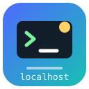

<p align="center"></p>
<p align="center"><strong>dsh-local-opencode</strong></p>

[English](README.md) | 简体中文

# Local OpenCode —— 给 DeepSeek Harness 用

把你在 [opencode](https://opencode.ai) 里已经拿到的免费模型，直接变成 [DeepSeek Harness](https://github.com/deepseek-ai/deepseek-harness)（下称 `dsh`）里可选的模型。不用登录、不用填 API Key、不用另外买额度：插件找到你本机已经在跑的 opencode 服务，读出它当下真能服务的模型，把零成本的那些注册成一个模型提供方，于是 `dsh` 的模型选择器里会出现 **Local OpenCode** 分组。

## 为什么一定要经过本机 opencode

这是整个设计的核心决定，而且它是实测出来的，不是推测。opencode 的匿名免费通道不认直连客户端：拿公钥 `public`、按 OpenAI `chat/completions` 形状、按 `responses` 形状、甚至带上 opencode 自己发的全套归属头（`x-opencode-session-id`、`x-opencode-project`、`x-session-affinity`、`User-Agent: opencode/...`）去打

```
https://opencode.ai/inference/openai/v1
```

一律回 `FreeUsageLimitError`（免费额度到顶，提示去买 OpenCode Go）；而**同一个模型**改走本机 opencode 服务时约 1.5 秒就出字——因为额度绑在它的会话身份上。部分模型另外还有区域封锁（`RegionError`），所以插件把失败原样报出来，而不是装作能用。

一句话：本插件是**通往你本机 opencode 的桥**，不是它的第二个上游客户端。

## 你能拿到什么

| | |
|---|---|
| **模型分组** | `Local OpenCode`（只放零成本模型）与 `Local OpenCode · 计费模型`；后者默认空组会被 GUI 丢掉，所以默认你只会看到免费模型 |
| **目录来源** | 直接读本机 `GET /api/model`：以后在 opencode 里登录新渠道，模型自动出现，不用改插件 |
| **思考档位** | 映射到 opencode 的 model variant（`low` / `high` / `max` 等），只暴露目录里真声明了的档位 |
| **上下文/输出上限** | 从目录读真实数值，`dsh` 的预算与压缩据此工作 |
| **失败上报** | 区域拒绝、额度墙、限速各自归类，带 provider 给的退避时长，并且刻意不自动重试（不把一次额度墙付三次） |
| **状态接口** | `/api/local-opencode/status`、`/refresh`、`/test`，外面套与内核同级的准入围栏 |

## 安装

前提：同机装有 opencode 且已登录（`npm i -g @opencode/cli`，跑一次 `opencode`，或 `opencode serve`）。插件读的是它自己写下的 `~/.local/state/opencode/service.json`。

```powershell
# 从本地 checkout 装
dsh plugin --profile web add link:C:/path/to/dsh-local-opencode

# 发布到 npm 之后
dsh plugin --profile web add dsh-local-opencode
```

装完重启 `dsh`。`cordis.patch.yml` 这层 bundle patch 负责挂载，不需要再配任何东西。

## 配置

写在 `~/.dsh/local-opencode/settings.json`，可被 bundle 的 `config` 覆盖（config 优先）：

| 键 | 默认 | 作用 |
|---|---|---|
| `enabled` | `true` | 设 `false` 就不注册路由：分组从选择器消失，但配置保留 |
| `includePaid.githubCopilot` | `false` | 是否列出 GitHub Copilot 模型（由你的 Copilot 套餐计费） |
| `includePaid.others` | `false` | 是否列出其他非零成本渠道 |
| `refreshMinutes` | `30` | 后台刷新目录间隔；`0` 表示只在启动和手动刷新时拉 |
| `requestTimeoutMs` | `180000` | 单次上游超时（夹在 5 秒～30 分钟） |

环境变量 `OPENCODE_SERVER_URL` / `OPENCODE_SERVER_PASSWORD` 可绕过登记文件（这里允许非回环地址：你配的是自己的机器）。

## 一轮请求怎么走完

```
dsh GenerateOptions
  -> 历史压平成 prompt（系统提示 + 各轮 + 工具结果都转成文本）
  -> POST /api/session                     建会话
  -> POST /api/session/{id}/model          设模型 + variant（= 思考档位）
  -> POST /api/session/{id}/generate       一次无状态生成
  -> DELETE /api/session/{id}              放在 finally，一定会删
  -> block-start / text-delta / block-end / usage / finish
```

会话只是承载免费额度所绑定的那份身份。`generate` 本身不累积历史（实测：同一会话里问两次，第二次不记得第一次），这正好匹配 `dsh` 每轮重放完整上下文的方式；用完即删，也不会在你的 opencode 会话列表里留垃圾。

## 限制

- **不支持函数调用。** 这条通道进文本、出文本。工具声明被丢弃，历史压平成文本，末尾附一句告诉模型别声称要调工具。适合问答、起草、总结、分析；不适合当 `dsh` 里能改代码的 agent。
- **不支持图片输入。** 图片块投影成占位文本，并且 `inputModalities` 如实声明只有 `text`，让内核去做投影，而不是插件假装能吃图。
- **额度与区域是渠道的，不是插件的。** 目录是实时读的，所以模型数量随 opencode 自己的供给变动；插件不内置清单。你的网络够不着的模型会带着 `RegionError` 原因上报，额度墙则带上 provider 给的退避时长。
- **整轮返回。** opencode 一次性给完这段生成，所以回答是一个 delta 到达，不是逐字流。

## 开发

```powershell
npm run check            # 逐文件解析（本插件没有构建步骤，没人替你抓语法错）
npm test                 # bundle 清单 + 分类器 + 设置层 + 适配器契约
npm run test:live        # 打真实本机 opencode，每个免费模型各跑一轮
npm run test:kernel      # 打已发布的 dsh 内核（需要 DSH_ROOT）
```

| 套件 | 钉住什么 | 规模 |
|---|---|---|
| `check-syntax.mjs` | 每个模块都能解析 | 16 个文件 |
| `bundle-manifest-check.mjs` | bundle 挂载接线、发布文件清单、仓库元数据 | 28 项 |
| `test/classifier.mjs` | 失败映射逐分支钉死，含 failure 必须是自有属性 | 16 项 |
| `test/settings.mjs` | 默认值、覆盖顺序、夹取、原子落盘、重启读回 | 19 项 |
| `test/mock-runtime.mjs` | 适配器对上最小 cordis + 假 opencode 的完整契约 | 49 项 |
| `kernel-contract-check.mjs` | 对已发布内核核对方法集、chunk 类型、失败码 | 4 组 |
| `test/live.mjs` | 打真实本机 opencode，每个零成本模型各一轮 | 随环境 |

契约套件用最小 cordis 上下文 + 假 opencode 服务跑真插件，断言的就是真内核会断言的东西：`registerAdapter` 会对每条路由调 `providerInfo` 与 `providerRetryPolicy`，并要求退避字段在顶层；`prepareCall` 会被 await，其 `.model` 受同步校验（少写一个 `await` 就是把 Promise 交给校验，直接 `INVALID_MODEL_INFO`——真机上踩过，现已固化成断言）；`normalizeModelInfo` 要求 `id` 等于所请求的 model、name 非空、contextWindow 为整数、档位 id 唯一；流必须严格是 `block-start`、`text-delta`、`block-end`、`usage`、`finish`。

`scripts/kernel-contract-check.mjs` 补的是结构式实现留下的那道缝：它读已发布内核的源码，只要内核开始调用一个我们没实现的方法、出现一个它不认识的 chunk 类型、或我们产出的失败码不在它的词表里，就报错。

## 实测环境

| opencode | dsh | Node | 结果 |
|---|---|---|---|
| 2.2.5 | 0.2.1-rc.2 | 24.21 | 本机目录列出的零成本模型逐个约 1.5 秒出字；`crouton-alpha-free`、`beam-free` 回 `RegionError` |

## 许可

MIT —— 见 [LICENSE](LICENSE)。

