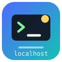

<p align="center"></p>
<p align="center"><strong>dsh-local-opencode</strong></p>

[English](README.md) | 简体中文

# Local OpenCode —— 给 DeepSeek Harness 用

[](https://www.npmjs.com/package/dsh-local-opencode) [](https://github.com/gzxc-vbnm/dsh-local-opencode/actions/workflows/ci.yml) 

把你在 [opencode](https://opencode.ai) 里已经拿到的免费模型，直接变成 [DeepSeek Harness](https://github.com/deepseek-ai/deepseek-harness)（下称 `dsh`）里可选的模型。不用登录、不用填 API Key、不用另外买额度：插件找到你本机已经在跑的 opencode 服务，读出它当下真能服务的模型，把零成本的那些注册成一个模型提供方，于是 `dsh` 的模型选择器里会出现 **Local OpenCode** 分组，左侧栏里也会多出一个同名入口。

## 为什么一定要经过本机 opencode

这是整个设计的核心决定，而且它是实测出来的，不是推测。opencode 的匿名免费通道不认直连客户端：拿公钥 `public`、按 OpenAI `chat/completions` 形状、按 `responses` 形状、甚至带上 opencode 自己发的全套归属头（`x-opencode-session-id`、`x-opencode-project`、`x-session-affinity`、`User-Agent: opencode/...`）去打

```
https://opencode.ai/inference/openai/v1
```

一律回 `FreeUsageLimitError`（免费额度到顶，提示去买 OpenCode Go）；而**同一个模型**改走本机 opencode 服务时约 1.5 秒就出字——因为额度绑在它的会话身份上。部分模型另外还有区域封锁（`RegionError`），所以插件把失败原样报出来，而不是装作能用。

一句话：本插件是**通往你本机 opencode 的桥**，不是它的第二个上游客户端。

## 两条通道，以及为什么默认是安全的那条

| | 无工具文本通道（默认） | 带工具 agent 通道 |
|---|---|---|
| 端点 | `POST /api/session/{id}/generate` | `POST /api/session/{id}/prompt` + `GET /api/event` |
| 工具 | 永远没有 | opencode 自己的 read / write / bash / grep 等 |
| 副作用 | 无 | **会真的读写你的文件** |
| 推理块 | 无 | 有，单独成块推给你 |
| 流式 | 一次给完 | 走事件流：文本、推理、步、用量、权限 |

默认走文本通道，因为它没有爆炸半径：进一段 prompt、出一段文本，磁盘上不会发生任何变化。agent 通道是完全另一条道——opencode 在你指定的工作目录里跑它自己的工具循环，`dsh` 只看得到最终文本与推理。需要文件系统的时候它真的有用，也正是插件不肯默认打开它的理由。

**权限策略不是摆设。** 在 opencode 2.3.0 上实测：`build` agent 的默认权限是 `*=allow`，工具会**静默执行**，连 `permission.asked` 事件都不发。也就是说，一个只「记录」权限设置的插件等于在骗人。这个插件在建会话时就把 `permissions` 下发下去：

| 策略 | 建会话时下发 | 收到 `permission.asked` 时 |
|---|---|---|
| 只放行读（默认） | `{action:"*", effect:"ask"}` | 读/搜索/列目录类回 `once`，其余一律 `reject` |
| 全部放行 | `{action:"*", effect:"allow"}` | 没有要答的，工具直接跑 |
| 一律拒绝 | `{action:"*", effect:"deny"}` | 没有要答的，服务端自己拒（实测：文件确实没被写） |

## 你能拿到什么

| | |
|---|---|
| **模型分组** | `Local OpenCode`（只放零成本模型）与 `Local OpenCode · 计费模型`；后者默认空组会被 GUI 丢掉，所以默认你只会看到免费模型 |
| **目录来源** | 直接读本机 `GET /api/model`：以后在 opencode 里登录新渠道，模型自动出现，不用改插件 |
| **思考档位** | 映射到 opencode 的 model variant（`low` / `high` / `max` 等），只暴露目录里真声明了的档位 |
| **上下文/输出上限** | 从目录读真实数值，`dsh` 的预算与压缩据此工作 |
| **失败上报** | 区域拒绝、额度墙、限速各自归类，带 provider 给的退避时长，并且刻意不自动重试（不把一次额度墙付三次）。区域拒绝归 `INVALID_REQUEST` 而不是 `AUTH`：聊天 UI 会把 `AUTH` 改写成固定的「API 密钥无效」，真正的原因会被丢掉 |
| **侧栏面板** | 左侧栏多出一行 **Local OpenCode**：逐模型的显示/不显示、通道切换、agent 通道的权限与目录设置，都在同一页 |
| **两条通道** | *无工具文本*（无状态、无工具、无副作用）或 *agent*（opencode 自己的工具循环，真的读写你的文件，受你选的权限策略约束） |
| **状态接口** | `/api/local-opencode/status`、`/refresh`、`/test`、`/visibility`、`/channel`、`/agent-settings`、`/agents`，外面套与内核同级的准入围栏 |

## 安装

前提：同机装有 opencode 且已登录（`npm i -g @opencode/cli`，跑一次 `opencode`，或 `opencode serve`）。插件读的是它自己写下的 `~/.local/state/opencode/service.json`。

```powershell
# 从 npm 装
dsh plugin --profile web add dsh-local-opencode

# 或从本地 checkout 装
dsh plugin --profile web add link:C:/path/to/dsh-local-opencode
```

装完重启 `dsh`。`cordis.patch.yml` 这层 bundle patch 负责挂载，不需要再配任何东西。

这个包在一个挂载行后面装了两个半边：宿主半边（`index.js`，模型适配器与它的 HTTP 路由）与浏览器半边（`client.js`，侧栏面板与它那一页）。`package.json` 两个都声明了——`exports["./client"]` 指向浏览器 bundle，`dsh.client.inject` 列出声明这两个座位的外壳包（ui-sidebar 的 `sidebar.panellist`、ui-layout 的 `main`、ui-renderer 的 `slots`）。如果侧栏那行没出现，说明浏览器半边没加载：先确认 `dsh.client.inject` 里每个名字在你的 profile 里都能解析到。

## 配置

写在 `~/.dsh/local-opencode/settings.json`，可被 bundle 的 `config` 覆盖（config 优先）：

| 键 | 默认 | 作用 |
|---|---|---|
| `enabled` | `true` | 设 `false` 就不注册路由：分组从选择器消失，但配置保留 |
| `includePaid.githubCopilot` | `false` | 是否列出 GitHub Copilot 模型（由你的 Copilot 套餐计费） |
| `includePaid.others` | `false` | 是否列出其他非零成本渠道 |
| `refreshMinutes` | `30` | 后台刷新目录间隔；`0` 表示只在启动和手动刷新时拉 |
| `requestTimeoutMs` | `180000` | 文本通道的单次上游超时（夹在 5 秒～30 分钟） |
| `channel` | `text` | `text`（无工具）或 `agent`（带工具）；在侧栏里切 |
| `hiddenModels` | `[]` | 侧栏里被关掉的模型 id：它们退出所有路由分组，但留在目录里 |
| `permissionMode` | `allow-read` | `allow-read` / `allow-all` / `reject` —— agent 通道允许做什么（见上文） |
| `workingDirectory` | 空 | agent 通道的工具在哪个目录里跑；空表示沿用 opencode 自己的位置 |
| `agentName` | 空 | 用哪个 opencode agent；空表示服务端默认 |
| `agentTurnTimeoutMs` | `600000` | 一整轮 agent 的上限（毫秒），含多次工具往返 |

环境变量 `OPENCODE_SERVER_URL` / `OPENCODE_SERVER_PASSWORD` 可绕过登记文件（这里允许非回环地址：你配的是自己的机器）。

## 侧栏面板

左侧栏里多出一行 **Local OpenCode**（order 40，排在内置面板之后）。点开的那一页就是本插件存在的两个开关：

- **模型显示。** 目录里每个模型都列出来，带 provider、免费/计费徽标和上下文窗口。点「不显示」就把它从模型选择器里摘掉，条目仍留在这一页，随时能拨回来。每次点击都真的往返宿主再按服务端的回答重绘——**不做乐观更新**，因为改的是选择器的成员表，猜错比慢半拍更难查。
- **通道。** 无工具文本 / 带工具 agent。切换立即生效：适配器在派发一轮的时候读通道，所以下一条消息就走新道，不用重启。

选到 agent 通道后，同一页还会出现权限策略（每个选项都写着后果）、工作目录、以及用哪个 opencode agent。该区顶部有一条红色提示，直说模型会真的读写文件——因为它真的会。

## 一轮请求怎么走完

**文本通道**（默认）：

```
dsh GenerateOptions
  -> 历史压平成 prompt（系统提示 + 各轮 + 工具结果都转成文本）
  -> POST /api/session                     建会话
  -> POST /api/session/{id}/model          设模型 + variant（= 思考档位）
  -> POST /api/session/{id}/generate       一次无状态生成
  -> DELETE /api/session/{id}              放在 finally，一定会删
  -> block-start / text-delta / block-end / usage / finish
```

**agent 通道**：

```
dsh GenerateOptions
  -> GET  /api/event                       先开流，types 用重复参数
  -> POST /api/session                     建会话，带上 permissions + agent + location
  -> POST /api/session/{id}/prompt         只是入队；产出全在流里
  -> 消费事件：文本与推理 delta、步与用量 token、permission.asked
  -> POST /api/session/{id}/permission/{id}/reply   按策略逐条代答
  -> 断流兜底：GET /api/session/{id}/message        流提前结束时改写持久化消息
  -> DELETE /api/session/{id}              放在 finally，一定会删
```

事件流必须在 `prompt` **之前**打开，因为 `prompt` 只回一句「用户消息已入队」，其余全靠事件。opencode 自己写明这条流是 volatile 的（慢消费者会被丢掉），所以一旦流在终态事件之前结束，插件去读已经持久化的 assistant 消息，而不是报传输失败。

## 限制

- **文本通道不支持函数调用。** 那条道进文本、出文本。工具声明被丢弃，历史压平成文本，末尾附一句告诉模型别声称要调工具。需要动文件就切到 agent 通道。
- **agent 通道的工具是 opencode 的，不是 `dsh` 的。** `dsh` 照旧声明它的工具，在这条道上同样被丢弃；真正跑的是 opencode 自己的工具集，在你配的工作目录里。模型调不到 `dsh` 的工具，`dsh` 也看不到那些工具调用——只看到最终文本与推理。
- **agent 一轮更慢，且有 `agentTurnTimeoutMs` 封顶。** 一轮里可能包含多次工具往返，默认上限十分钟。
- **不支持图片输入。** 图片块投影成占位文本，并且 `inputModalities` 如实声明只有 `text`，让内核去做投影，而不是插件假装能吃图。
- **额度与区域是渠道的，不是插件的。** 目录是实时读的，所以模型数量随 opencode 自己的供给变动；插件不内置清单。你的网络够不着的模型会带着 `RegionError` 原因上报（归 `INVALID_REQUEST`，这是 UI 会原样显示的那个码），额度墙则带上 provider 给的退避时长。
- **文本通道整轮返回。** 它的 `generate` 一次给完这段生成，所以回答是一个 delta 到达，不是逐字流。agent 通道是流式的，因为它读的是事件流而不是响应体。

## 开发

```powershell
npm run check            # 逐文件解析（本插件没有构建步骤，没人替你抓语法错）
npm test                 # bundle 清单 + 分类器 + 设置层 + 适配器契约 + 侧栏面板 + 浏览器半边
npm run test:live        # 打真实本机 opencode，每个免费模型各跑一轮
npm run test:kernel      # 打已发布的 dsh 内核（需要 DSH_ROOT）
```

| 套件 | 钉住什么 | 规模 |
|---|---|---|
| `check-syntax.mjs` | 每个模块都能解析 | 21 个文件 |
| `bundle-manifest-check.mjs` | bundle 挂载接线、两个半边、发布文件清单、仓库元数据 | 43 项 |
| `test/classifier.mjs` | 失败映射逐分支钉死，含 failure 必须是自有属性 | 16 项 |
| `test/settings.mjs` | 默认值、覆盖顺序、夹取、原子落盘、重启读回 | 19 项 |
| `test/mock-runtime.mjs` | 适配器对上最小 cordis + 假 opencode 的完整契约 | 49 项 |
| `test/panel.mjs` | 侧栏路由与两条通道打假服务器：显隐、切通道、三种权限策略、断流兜底 | 45 项 |
| `test/client.mjs` | 浏览器半边：模块包裹、座位注册、两条通道的页面渲染 | 33 项 |
| `kernel-contract-check.mjs` | 对已发布内核核对方法集、chunk 类型、失败码 | 4 组 |
| `test/live.mjs` | 打真实本机 opencode，每个零成本模型各跑一轮 | 随环境 |

契约套件用最小 cordis 上下文 + 假 opencode 服务跑真插件，断言的就是真内核会断言的东西：`registerAdapter` 会对每条路由调 `providerInfo` 与 `providerRetryPolicy`，并要求退避字段在顶层；`prepareCall` 会被 await，其 `.model` 受同步校验（少写一个 `await` 就是把 Promise 交给校验，直接 `INVALID_MODEL_INFO`——真机上踩过，现已固化成断言）；`normalizeModelInfo` 要求 `id` 等于所请求的 model、name 非空、contextWindow 为整数、档位 id 唯一；流必须严格是 `block-start`、`text-delta`、`block-end`、`usage`、`finish`。

`scripts/kernel-contract-check.mjs` 补的是结构式实现留下的那道缝：它读已发布内核的源码，只要内核开始调用一个我们没实现的方法、出现一个它不认识的 chunk 类型、或我们产出的失败码不在它的词表里，就报错。

## 实测环境

| opencode | dsh | Node | 结果 |
|---|---|---|---|
| 2.2.5 | 0.2.1-rc.2 | 24.21 | 本机目录列出的零成本模型逐个约 1.5 秒出字；`crouton-alpha-free`、`beam-free` 回 `RegionError` |
| 2.3.0 | 0.2.2-rc.1 | 22.19 | agent 通道的事件流与三种权限策略手工打穿：`ask` 会挂起到应答，`deny` 下文件确实没被写，`allow` 下静默执行 |

## 许可

MIT —— 见 [LICENSE](LICENSE)。
